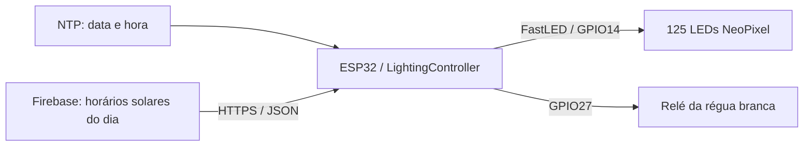

# LightingController

**Iluminação de aquário plantado guiada pelo ciclo solar, com ESP32, NeoPixel e Firebase.**

O LightingController ajusta o brilho e as cores de uma fita de LEDs ao longo do dia e aciona uma régua de luz branca por relé perto do zênite. Os horários de amanhecer, nascer do sol, zênite, pôr do sol e anoitecer vêm do Firebase Realtime Database; o relógio é sincronizado por NTP.

Este repositório contém o firmware de iluminação extraído do projeto `WebServer`. A leitura de sensores e a gravação de históricos pertencem ao projeto separado `SensorsController`, descrito em [Divisão dos projetos](docs/SPLIT_PROJECTS.md).

[Como funciona](#como-funciona) · [Hardware](#hardware) · [Instalação](#instalação-e-compilação) · [Dados solares](#dados-solares-no-firebase) · [Configurações](#configurações) · [Diagnóstico](#diagnóstico)

## Como funciona



Ao ligar, o firmware deixa os LEDs e o relé desligados, tenta conectar ao Wi-Fi e sincroniza o horário. Depois, consulta os dados solares da data atual e inicia o controle da iluminação. Sem horário válido ou sem uma primeira leitura solar válida, a iluminação permanece desligada.

Durante a execução, o firmware tenta restabelecer o Wi-Fi quando necessário, atualiza o relógio quando conectado e busca novos horários solares diariamente às **04:50**, no horário local configurado. Enquanto ainda não tiver carregado dados solares válidos, repete a tentativa de leitura a cada 30 segundos.

### Ciclo de iluminação

O brilho base usa interpolação com curva *smoothstep*, com atualização a cada **60 segundos**. Os valores abaixo são os atuais de `config.h`, na escala de 0 a 255.

| Fase | Comportamento do brilho base |
| --- | --- |
| Antes da janela de luz | LEDs apagados e relé desligado |
| Início da janela de luz → nascer do sol | Sobe de 0 até 55 |
| Nascer do sol → zênite | Sobe de 55 até 230 |
| Zênite → pôr do sol | Desce de 230 até 55 |
| Pôr do sol → fim da janela de luz | Desce de 55 até 0 |
| Depois da janela de luz | LEDs apagados e relé desligado |

A janela começa no horário mais tardio entre o amanhecer e `nascer do sol − 20 min`. Termina no horário mais cedo entre o anoitecer e `pôr do sol + 20 min`. O relé liga entre **120 minutos antes e 120 minutos depois do zênite**, dentro dessa janela.

As cinco fileiras lógicas recebem cores branca, vermelha, azul, neutra e âmbar. Intensidade e saturação variam conforme a proximidade do zênite; as duas primeiras e as duas últimas colunas recebem uma redução adicional de brilho. O brilho base da tabela passa por esses ajustes antes de chegar a cada LED.

### Comportamento em falhas

| Situação | Resposta do firmware |
| --- | --- |
| Horário ainda inválido | Mantém LEDs e relé desligados e tenta sincronizar novamente |
| Primeira leitura solar falha | Mantém a iluminação desligada e repete a consulta |
| Nova leitura solar inválida, após uma leitura válida | Preserva os últimos horários válidos |
| Wi-Fi cai após a sincronização e a leitura solar | Tenta reconectar e pode continuar o ciclo com os dados já carregados |
| Fora da janela de luz ou com sequência solar aplicada inválida | Apaga a fita e coloca o relé em `LOW` |

Os horários solares ficam em memória RAM; um reinício exige nova sincronização e leitura. O firmware não grava esses dados em armazenamento persistente.

## Hardware

A placa alvo identificada na documentação do projeto é a **ESP32/Wemos D1 R32**, com identificador Arduino **`esp32:esp32:d1_uno32`**.

| Componente | Configuração presente no código |
| --- | --- |
| Fita de LEDs endereçáveis | Tipo `NEOPIXEL`, controlada pela FastLED |
| Sinal da fita | GPIO14 (`LED_PIN`) |
| Quantidade e organização | 125 LEDs; 5 fileiras lógicas de 25 LEDs |
| Relé da régua LED branca | GPIO27 (`LED_RELAY_PIN`), ligado em `HIGH` e desligado em `LOW` |
| Monitor serial | 9600 baud |

Este firmware não lê sensores. Não há esquema elétrico nem especificação de fonte, módulo de relé ou modelo exato da fita neste repositório. A tabela registra a pinagem e a organização definidas no software; confira o hardware utilizado antes de gravar o firmware.

## Instalação e compilação

Você precisará do Git para clonar o repositório e da Arduino IDE ou Arduino CLI para compilar. A compilação pode ser feita sem uma placa conectada.

### 1. Obter o projeto

```powershell
git clone https://github.com/anvmano/LightingController.git
cd LightingController
```

Mantenha o nome da pasta `LightingController`: ela contém o sketch principal `LightingController.ino` e suas abas `.ino`.

### 2. Preparar as credenciais locais

Copie o exemplo, se ainda não tiver um `secrets.h` local. No PowerShell:

```powershell
Copy-Item secrets.example.h secrets.h
```

Edite o novo `secrets.h`, preservando os nomes, tipos e declarações do exemplo:

| Configuração | O que preencher |
| --- | --- |
| `ssid` | Nome da sua rede Wi-Fi |
| `password` | Senha da rede Wi-Fi |
| `FIREBASE_HOST` | URL HTTPS da raiz do seu Firebase Realtime Database, sem caminho de dados nem parâmetros de autenticação |
| `FIREBASE_AUTH` | Credencial aceita pelo seu banco para ler os dados solares |

O host pode ter ou não uma barra final. O código acrescenta o caminho do dia e o parâmetro de autenticação ao montar a requisição.

O arquivo real `secrets.h` é ignorado pelo Git. Apenas [secrets.example.h](secrets.example.h), com placeholders, deve ser versionado. Preserve suas credenciais também fora de comentários, exemplos, capturas do monitor serial e arquivos de documentação. O `.gitignore` exclui credenciais locais, chaves privadas, backups, logs, artefatos de compilação e configurações pessoais comuns.

### 3. Instalar as dependências

Esta combinação foi **validada por compilação** para a placa alvo:

| Dependência | Versão validada | Uso |
| --- | --- | --- |
| Core ESP32 (`esp32:esp32`) | 2.0.14 | Wi-Fi, UDP, cliente HTTP e TLS |
| NTPClient | 3.2.1 | Sincronização do relógio |
| Time (`TimeLib.h`) | 1.6.1 | Conversão de data e hora |
| ArduinoJson | 7.4.3 | Leitura do JSON solar, usando `JsonDocument` |
| FastLED | 3.6.0 | Controle dos LEDs NeoPixel |

`WiFi.h`, `HTTPClient.h`, `WiFiClientSecure.h` e `WiFiUdp.h` acompanham o core ESP32. O acesso ao Firebase usa REST/HTTPS; não há biblioteca específica do Firebase entre os includes.

**Arduino CLI**

Os comandos abaixo usam o [índice estável de placas indicado pela Espressif](https://docs.espressif.com/projects/arduino-esp32/en/latest/installing.html):

```powershell
arduino-cli core update-index --additional-urls https://espressif.github.io/arduino-esp32/package_esp32_index.json
arduino-cli core install esp32:esp32@2.0.14 --additional-urls https://espressif.github.io/arduino-esp32/package_esp32_index.json
arduino-cli lib update-index
arduino-cli lib install "NTPClient@3.2.1" "Time@1.6.1" "ArduinoJson@7.4.3" "FastLED@3.6.0"
```

**Arduino IDE**

Adicione o índice estável da Espressif às URLs adicionais do Gerenciador de Placas, instale o pacote **esp32** na versão acima e selecione **WEMOS D1 R32**. Pelo Gerenciador de Bibliotecas, instale as versões da tabela. Abra `LightingController.ino` e use **Verificar** para compilar.

### 4. Compilar e gravar

Na pasta do sketch, com `secrets.h` já criado:

```powershell
arduino-cli compile --warnings all --fqbn esp32:esp32:d1_uno32 --build-path build .
```

Para gravar, conecte a placa e identifique a porta:

```powershell
arduino-cli board list
```

Substitua `COM3` pela porta da sua placa. O envio abaixo utiliza os binários da compilação anterior:

```powershell
arduino-cli upload --fqbn esp32:esp32:d1_uno32 --port COM3 --input-dir build .
arduino-cli monitor --port COM3 --config baudrate=9600
```

Na IDE, selecione a porta, use **Carregar** e abra o Monitor Serial em **9600 baud**. Os binários compilados contêm os valores de configuração local; a pasta `build/` é ignorada pelo Git.

## Dados solares no Firebase

O firmware consulta a data local atual no caminho:

```text
/historico/NascePorDoSol/DD-MM-AAAA
```

Outro componente precisa disponibilizar esses horários no banco. O LightingController apenas os lê; não calcula eventos solares a partir de coordenadas e não grava histórico.

O conteúdo do nó de cada dia deve ser um **objeto com um ou mais objetos filhos**. Por exemplo, este é um payload fictício para o nó do dia, com horários apenas ilustrativos:

```json
{
  "exemplo": {
    "HoraAmanhecer": 5,
    "MinuteAmanhecer": 40,
    "HourNascerDoSol": 6,
    "MinuteNascerDoSol": 0,
    "HoraZenite": 12,
    "MinuteZenite": 0,
    "HoraPorDoSol": 18,
    "MinutePorDoSol": 0,
    "HourAnoitecer": 18,
    "MinuteAnoitecer": 20
  }
}
```

| Evento | Campo de hora | Campo de minuto |
| --- | --- | --- |
| Amanhecer | `HoraAmanhecer` | `MinuteAmanhecer` |
| Nascer do sol | `HourNascerDoSol` | `MinuteNascerDoSol` |
| Zênite, opcional | `HoraZenite` | `MinuteZenite` |
| Pôr do sol | `HoraPorDoSol` | `MinutePorDoSol` |
| Anoitecer | `HourAnoitecer` | `MinuteAnoitecer` |

Forneça horas e minutos como números inteiros, no mesmo horário local usado pelo firmware. A sequência deve respeitar:

```text
amanhecer < nascer do sol < zênite < pôr do sol < anoitecer
```

Se a hora ou o minuto do zênite estiver ausente ou negativo, o firmware usa o ponto médio entre nascer e pôr do sol antes de validar a sequência. Os nomes dos campos diferenciam maiúsculas e minúsculas: preserve inclusive a combinação de `Hora` e `Hour` mostrada na tabela.

O nome `exemplo` é apenas a chave de um filho; pode ser substituído por outra chave. Se houver vários filhos, o firmware percorre todos e aplica o **último conjunto válido encontrado na iteração**. Filhos inválidos não sobrescrevem os dados válidos já carregados.

## Configurações

As constantes de operação ficam em [config.h](config.h). Estes são os valores publicados:

| Constante | Valor | Efeito |
| --- | --- | --- |
| `NTP_TIME_OFFSET_SECONDS` | −10.800 s | Horário local UTC−3, com offset fixo |
| `MIN_VALID_YEAR` | 2024 | Ano mínimo para considerar o relógio válido |
| `WIFI_CONNECT_TIMEOUT_MS` | 20.000 ms | Limite de espera de cada tentativa de conexão |
| `WIFI_RECONNECT_INTERVAL_MS` | 30.000 ms | Intervalo de reconexão e novas tentativas iniciais de sincronização |
| `FIREBASE_HTTP_TIMEOUT_MS` | 10.000 ms | Timeout da requisição HTTP |
| `LED_UPDATE_INTERVAL` | 60.000 ms | Intervalo de atualização da iluminação |
| `LED_PRE_SUNRISE_MINUTES` / `LED_POST_SUNSET_MINUTES` | 20 / 20 min | Extensão da janela antes do nascer e depois do pôr do sol |
| `LED_SUNRISE_BRIGHTNESS` / `LED_SUNSET_BRIGHTNESS` | 55 / 55 | Brilho base no nascer e no pôr do sol |
| `LED_PLANTED_TANK_MAX_BRIGHTNESS` | 230 | Pico do brilho base da curva |
| `MAX_PWM_VALUE` | 255 | Limite da escala e brilho global da FastLED |
| `LED_RELAY_WINDOW_MINUTES` | 120 min | Janela do relé para cada lado do zênite |
| `SUN_SYNC_HOUR` / `SUN_SYNC_MINUTE` | 4 / 50 | Horário diário de consulta dos dados solares |

O servidor NTP é `pool.ntp.org`, definido no sketch principal. O offset UTC−3 não faz ajuste automático de horário de verão. Ajustes no fotoperíodo, brilho ou pinagem alteram a operação física do aquário e devem ser compatíveis com a instalação utilizada.

## Estrutura do projeto

| Arquivo | Responsabilidade |
| --- | --- |
| [LightingController.ino](LightingController.ino) | Includes, objetos globais, inicialização e loop principal |
| [config.h](config.h) | Pinos, intervalos, brilho e agenda |
| [secrets.example.h](secrets.example.h) | Modelo para criar o `secrets.h` local |
| [01_Utils.ino](01_Utils.ino) | Data, relógio NTP e conversão para minutos do dia |
| [02_Connectivity.ino](02_Connectivity.ino) | Conexão Wi-Fi com timeout |
| [03_WeatherAndSun.ino](03_WeatherAndSun.ino) | Consulta REST e interpretação dos horários solares |
| [04_Actuators.ino](04_Actuators.ino) | Curva de brilho, cores, relé e desligamento |
| [05_Tasks.ino](05_Tasks.ino) | Reconexão e agendamento das tarefas periódicas |
| [docs/](docs/) | Documentação detalhada de arquitetura e regras |

## Diagnóstico

Use o Monitor Serial em **9600 baud**. Estas mensagens e situações ajudam a localizar problemas:

| Mensagem ou sintoma | O que conferir |
| --- | --- |
| `secrets.h: No such file or directory` na compilação | Crie o arquivo local a partir de `secrets.example.h` |
| Biblioteca não encontrada | Instale as dependências e selecione o core ESP32 |
| `Erro: timeout ao conectar no WiFi.` | SSID, senha e disponibilidade da rede |
| `Horario nao sincronizado: falha ao consultar NTP.` | Conectividade e acesso ao servidor NTP |
| `Erro HTTP ao ler horarios solares:` | Código HTTP retornado, host, credencial e permissão de leitura do banco |
| `Erro ao fazer o parsing do JSON:` | Estrutura do conteúdo retornado pelo Firebase |
| `Horarios solares invalidos no Firebase. Mantendo ultimos valores validos.` | Campos numéricos, nomes exatos e ordem dos eventos |
| LEDs apagados após o boot | Horário sincronizado, primeira leitura solar válida e janela de luz atual |
| Dados do dia anterior continuam em uso | Se a consulta das 04:50 teve sucesso; a rotina não possui verificação de validade por data dos dados já carregados |

## Validação e limites atuais

A compilação foi concluída com sucesso para `esp32:esp32:d1_uno32` com as versões listadas. A validação não incluiu gravação na placa, teste físico dos LEDs/relé nem acesso a serviços com credenciais reais. Não há suíte de testes automatizados no repositório.

O cliente HTTPS utiliza `WiFiClientSecure::setInsecure()`, portanto não valida o certificado do servidor. A sincronização solar diária depende de o loop executar durante o minuto configurado; após uma leitura válida, os dados anteriores permanecem em uso se a atualização diária falhar. As rotinas de rede também podem bloquear o loop até os timeouts configurados.

## Documentação complementar

- [Arquitetura e fluxo de execução](docs/ARCHITECTURE_AI.md)
- [Regras do ciclo de iluminação](docs/BUSINESS_RULES.md)
- [Mapa de dependências e chamadas](docs/DEPENDENCY_MAP.md)
- [Divisão entre iluminação e sensores](docs/SPLIT_PROJECTS.md)
- [Contexto rápido do projeto](docs/AI_QUICK_CONTEXT.md)
