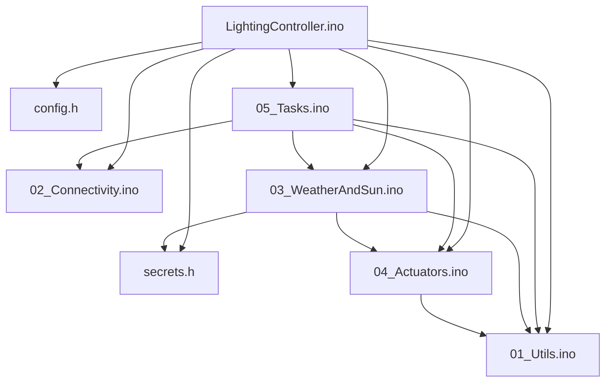
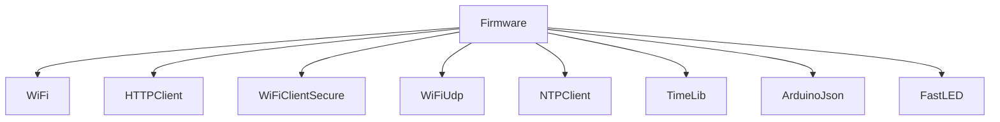
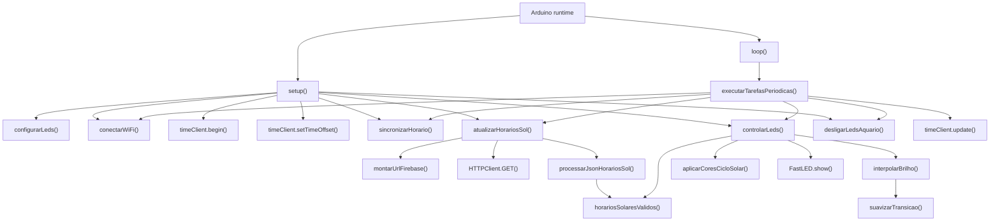

# DEPENDENCY_MAP

Projeto atual:

```text
LightingController/
```

## Diagrama Geral



## Bibliotecas



## LightingController.ino

### Responsabilidade

Declarar bibliotecas, objetos globais, variaveis de horarios solares, `setup()` e `loop()`.

### Dependencias Diretas

- `WiFi`
- `HTTPClient`
- `WiFiClientSecure`
- `WiFiUdp`
- `NTPClient`
- `TimeLib`
- `ArduinoJson`
- `FastLED`
- `config.h`
- `secrets.h`
- funcoes de todas as abas `.ino`

### Quem chama

Runtime Arduino chama `setup()` e `loop()`.

### Quem e chamado

- `configurarLeds`
- `conectarWiFi`
- `sincronizarHorario`
- `atualizarHorariosSol`
- `controlarLeds`
- `desligarLedsAquario`
- `executarTarefasPeriodicas`

### Impacto da alteracao

Critico. Afeta boot, estado global e fluxo principal.

## config.h

### Responsabilidade

Centralizar constantes de tempo, Firebase HTTP, NTP, pinos, layout e brilho.

### Dependencias Diretas

Nenhuma.

### Quem chama

Todos os arquivos que usam constantes.

### Impacto da alteracao

Critico para pinos/rele; alto para fotoperiodo e brilho.

## secrets.h

### Responsabilidade

Fornecer `ssid`, `password`, `FIREBASE_HOST` e `FIREBASE_AUTH`.

### Quem chama

- `02_Connectivity.ino`
- `03_WeatherAndSun.ino`

### Impacto da alteracao

Critico. Pode impedir Wi-Fi ou leitura solar. Tambem e arquivo sensivel.

## 01_Utils.ino

### Responsabilidade

Formatar data, calcular minuto do dia, validar e sincronizar horario.

### Dependencias Diretas

- `timeClient`
- `WiFi.status()`
- TimeLib: `day`, `month`, `year`
- `MIN_VALID_YEAR`

### Quem chama

- `LightingController.ino`
- `03_WeatherAndSun.ino`
- `04_Actuators.ino`
- `05_Tasks.ino`

### Quem e chamado

- `timeClient.forceUpdate`
- `timeClient.getEpochTime`

### Impacto da alteracao

Alto. Pode quebrar data do Firebase ou agenda da iluminacao.

## 02_Connectivity.ino

### Responsabilidade

Conectar Wi-Fi com timeout e definir hostname.

### Dependencias Diretas

- `WiFi`
- `ssid`
- `password`
- `WIFI_CONNECT_TIMEOUT_MS`

### Quem chama

- `LightingController.ino`
- `05_Tasks.ino`

### Quem e chamado

- `WiFi.hostname`
- `WiFi.begin`
- `WiFi.status`
- `WiFi.localIP`

### Observacoes de comportamento

`conectarWiFi()` bloqueia ate conectar ou ate `WIFI_CONNECT_TIMEOUT_MS`. No `setup()`, o retorno nao interrompe o fluxo; falhas aparecem depois em `sincronizarHorario()` e `atualizarHorariosSol()`.

### Impacto da alteracao

Alto. Afeta NTP e Firebase.

## 03_WeatherAndSun.ino

### Responsabilidade

Ler horarios solares do Firebase via REST/HTTPS e popular variaveis globais.

### Dependencias Diretas

- `WiFi`
- `WiFiClientSecure`
- `HTTPClient`
- `ArduinoJson`
- `FIREBASE_HOST`
- `FIREBASE_AUTH`
- `obterDataFormatada`
- `calcularMinutoDoDia`
- `horariosSolaresValidos`

### Quem chama

- `LightingController.ino`
- `05_Tasks.ino`

### Quem e chamado

- `montarUrlFirebase`
- `HTTPClient.GET`
- `deserializeJson`

### Observacoes de comportamento

`atualizarHorariosSol()` retorna `false` se Wi-Fi estiver desconectado, se `http.begin()` falhar, se o status HTTP nao for `HTTP_CODE_OK`, se o JSON nao parsear ou se nenhum filho valido for encontrado. Filhos validos sobrescrevem as variaveis globais; filhos invalidos nao apagam valores anteriores.

### Impacto da alteracao

Alto. Afeta diretamente a disponibilidade da curva de LEDs.

## 04_Actuators.ino

### Responsabilidade

Configurar e controlar fita NeoPixel/FastLED, curva de brilho, cores por fileira, desligamento seguro e rele branco.

### Dependencias Diretas

- `FastLED`
- `leds`
- `timeClient`
- horarios solares globais
- constantes de LED/rele

### Quem chama

- `LightingController.ino`
- `03_WeatherAndSun.ino` usa `horariosSolaresValidos`
- `05_Tasks.ino`

### Quem e chamado

- `FastLED.addLeds`
- `FastLED.setBrightness`
- `FastLED.show`
- `digitalWrite`
- `fill_solid`

### Observacoes de comportamento

`controlarLeds()` nao consulta Wi-Fi nem Firebase. Ele usa o horario NTP atual e as variaveis solares globais. Se a ordem aplicada for invalida ou o minuto atual estiver fora da janela de luz, chama `desligarLedsAquario()`.

### Impacto da alteracao

Alto. Afeta atuadores fisicos.

## 05_Tasks.ino

### Responsabilidade

Orquestrar tarefas periodicas.

### Dependencias Diretas

- `WiFi`
- `timeClient`
- funcoes de conectividade, horario, Firebase REST e atuadores
- constantes de agenda

### Quem chama

- `loop()` em `LightingController.ino`

### Quem e chamado

- `conectarWiFi`
- `timeClient.update`
- `horarioSincronizado`
- `sincronizarHorario`
- `desligarLedsAquario`
- `atualizarHorariosSol`
- `controlarLeds`

### Observacoes de comportamento

Quando o horario esta invalido, esta aba retorna antes de tentar leitura solar ou atualizar LEDs. O retry solar em intervalo de reconexao acontece apenas enquanto `horariosSolaresCarregados` ainda e falso.

### Impacto da alteracao

Alto. Afeta frequencia, retry e estado seguro dos LEDs.

## Call Graph



## Dependencias Externas

- Roteador/rede Wi-Fi configurada em `secrets.h`.
- NTP `pool.ntp.org`.
- Firebase Realtime Database configurado em `secrets.h`.
- Dados solares ja existentes em `/historico/NascePorDoSol/DD-MM-AAAA`.
- Estrutura do JSON solar como objeto com filhos dinamicos contendo os campos esperados.
- Hardware da fita no `LED_PIN`.
- Hardware do rele no `LED_RELAY_PIN`.
